# Animated SVG Studio

[中文](README.md) · [English](README.en.md)

一个可移植的 Agent Skill，用于设计、生成、验证、预览和适配动画 SVG。支持 OpenCode / OpenChamber、Claude Code、Codex、独立 SVG、Web、React、Vue、微信公众号等受限富文本环境，以及静态回退方案。

## 特性

- 默认生成可独立运行的 SVG + SMIL，并配套自包含 HTML 预览。
- 支持 Web CSS / JavaScript、React、Vue 和交互式 SVG。
- 提供 SVG 安全性、结构、动画和平台兼容性检查。
- 提供保守优化器，避免破坏动画引用和时间轴。
- 内置 8 套语义化主题和 24 个中文 SVG 示例。
- 主题转换只替换字体与语义颜色，不会意外改变布局。
- 支持微信公众号等会清洗 HTML 的发布环境。
- 不依赖第三方 Python 包。

## 快速开始

### 安装为 Agent Skill

将整个目录复制或链接到 Agent 的 Skill 目录：

```text
OpenCode / OpenChamber  .agents/skills/animated-svg-studio/
Claude Code             .claude/skills/animated-svg-studio/
Codex                   .agents/skills/animated-svg-studio/
```

### 验证 SVG

```bash
python scripts/validate_svg.py assets/starter.svg --profile pure-svg
```

支持的配置：

- `web`：允许脚本和 Web 交互，但报告高风险结构。
- `pure-svg`：禁止脚本和内联事件，允许 SMIL。
- `wechat`：应用保守的富文本 SVG 限制。
- `email`：检查静态、自包含回退能力。

### 生成预览

```bash
python scripts/build_preview.py assets/starter.svg \
  -o starter-preview.html \
  --title "Animated SVG preview"
```

预览页支持响应式显示、减少动态效果、重播、下载 SVG 和复制源码。

### 应用主题

```bash
python scripts/apply_theme.py \
  examples/zh/default-theme/智能体双层架构.svg \
  -o output/智能体双层架构-科技.svg \
  --theme clear-tech
```

列出全部主题：

```bash
python scripts/apply_theme.py --list
```

### 检查兼容性与优化

```bash
python scripts/inspect_compatibility.py assets/starter.svg
python scripts/optimize_svg.py assets/starter.svg -o starter.min.svg
```

## 内置主题

| 主题 ID | 中文名称 | 适用场景 |
|---|---|---|
| `default-editorial` | 暖色编辑（默认） | 技术文章、架构说明、公众号配图 |
| `ink-paper` | 水墨纸张 | 中文叙事、知识图解、方法论 |
| `clear-tech` | 清透科技 | AI、云平台、API、SaaS |
| `dark-terminal` | 暗色终端 | 代码、Agent、日志、监控 |
| `fresh-green` | 自然生长 | 教育、协作、成长、可持续 |
| `bold-signal` | 强信号 | 发布、重点结论、风险与决策 |
| `crimson-conference` | 暗红大会 | 极简技术演讲、会议视觉 |
| `orange-blue-architecture` | 橙蓝架构 | API 流程、系统架构、技术方案 |

主题 Token 位于 [`assets/themes.json`](assets/themes.json)，选择规则位于 [`references/themes.md`](references/themes.md)。

## 主题示例矩阵

每套主题使用完全相同的布局和动画时间轴，便于直接比较字体、背景、文字、卡片、连线和强调色。点击缩略图可打开对应 SVG。

| 主题 | 智能体双层架构 | 文档审批流程 | 任务执行状态 |
|---|---|---|---|
| **暖色编辑（默认）**<br>`default-theme` | <a href="examples/zh/default-theme/智能体双层架构.svg">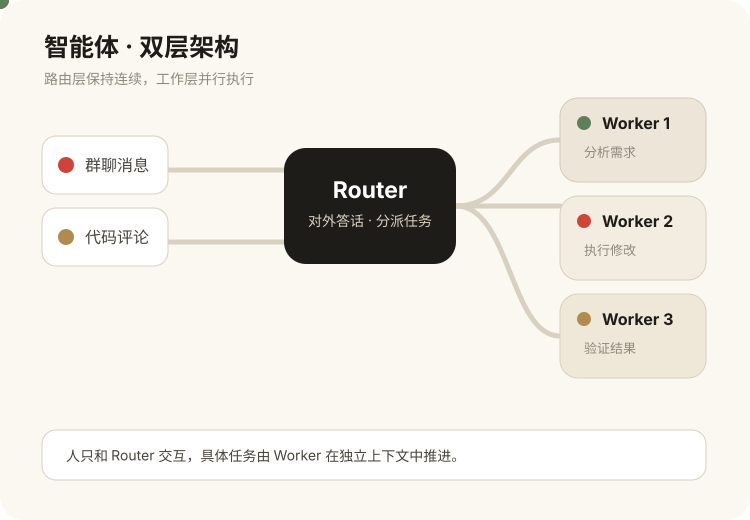</a> | <a href="examples/zh/default-theme/文档审批流程.svg"></a> | <a href="examples/zh/default-theme/任务执行状态.svg">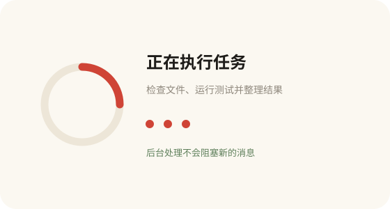</a> |
| **水墨纸张**<br>`ink-paper` | <a href="examples/zh/ink-paper/智能体双层架构.svg">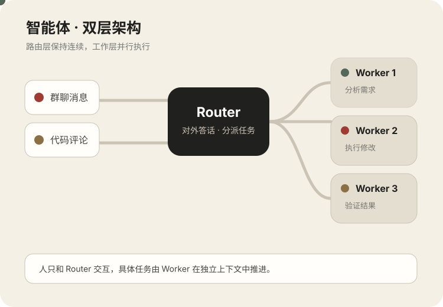</a> | <a href="examples/zh/ink-paper/文档审批流程.svg"></a> | <a href="examples/zh/ink-paper/任务执行状态.svg">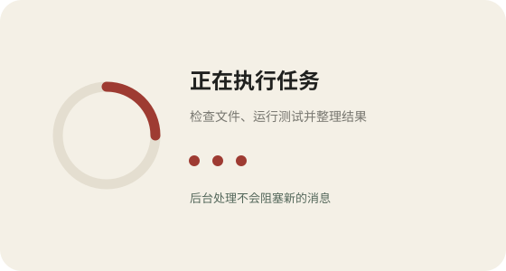</a> |
| **清透科技**<br>`clear-tech` | <a href="examples/zh/clear-tech/智能体双层架构.svg">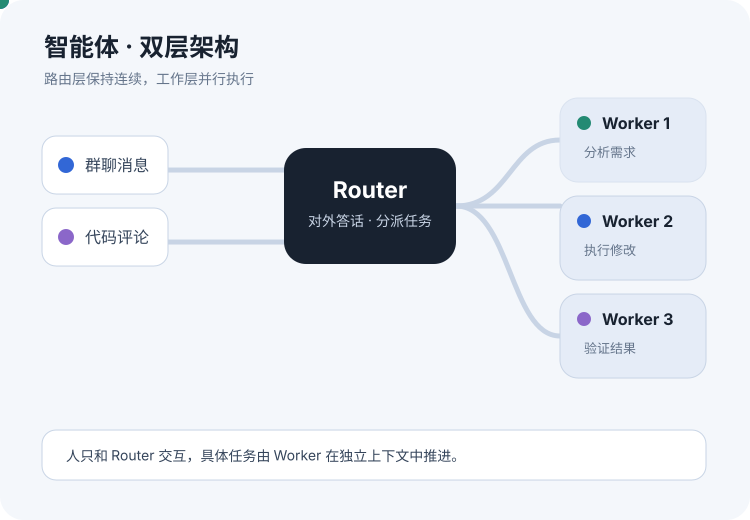</a> | <a href="examples/zh/clear-tech/文档审批流程.svg"></a> | <a href="examples/zh/clear-tech/任务执行状态.svg">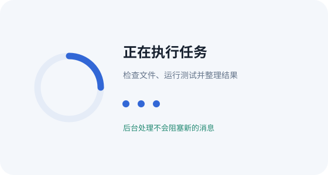</a> |
| **暗色终端**<br>`dark-terminal` | <a href="examples/zh/dark-terminal/智能体双层架构.svg">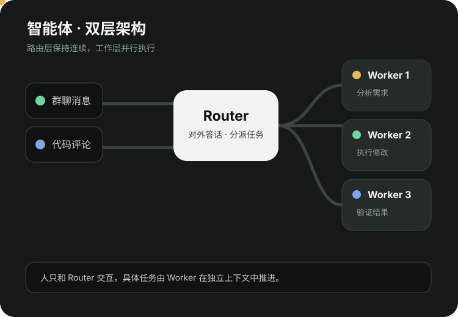</a> | <a href="examples/zh/dark-terminal/文档审批流程.svg"></a> | <a href="examples/zh/dark-terminal/任务执行状态.svg">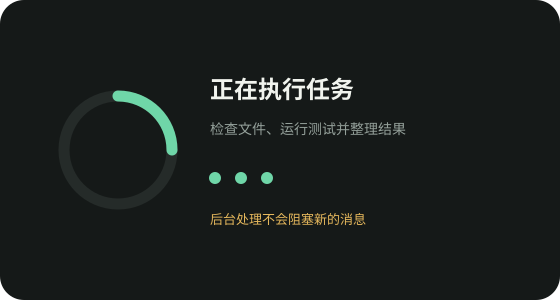</a> |
| **自然生长**<br>`fresh-green` | <a href="examples/zh/fresh-green/智能体双层架构.svg">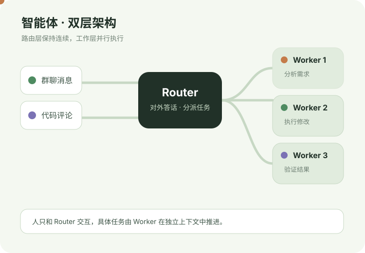</a> | <a href="examples/zh/fresh-green/文档审批流程.svg"></a> | <a href="examples/zh/fresh-green/任务执行状态.svg">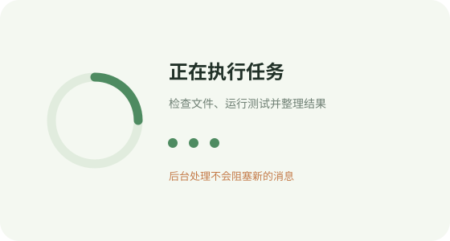</a> |
| **强信号**<br>`bold-signal` | <a href="examples/zh/bold-signal/智能体双层架构.svg">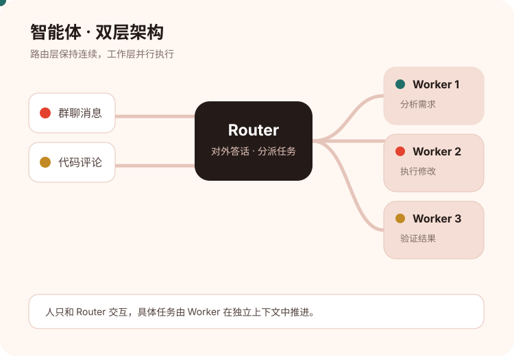</a> | <a href="examples/zh/bold-signal/文档审批流程.svg"></a> | <a href="examples/zh/bold-signal/任务执行状态.svg">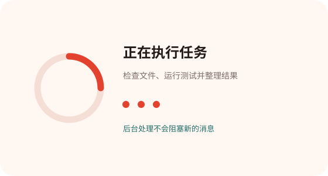</a> |
| **暗红大会**<br>`crimson-conference` | <a href="examples/zh/crimson-conference/智能体双层架构.svg">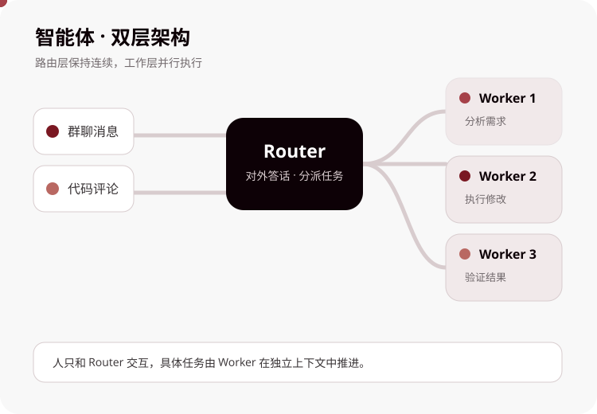</a> | <a href="examples/zh/crimson-conference/文档审批流程.svg"></a> | <a href="examples/zh/crimson-conference/任务执行状态.svg">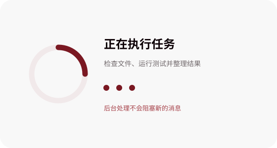</a> |
| **橙蓝架构**<br>`orange-blue-architecture` | <a href="examples/zh/orange-blue-architecture/智能体双层架构.svg">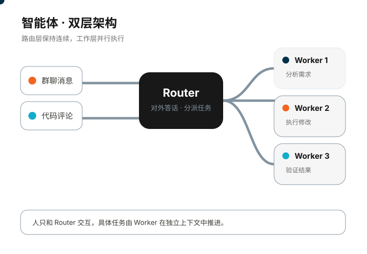</a> | <a href="examples/zh/orange-blue-architecture/文档审批流程.svg"></a> | <a href="examples/zh/orange-blue-architecture/任务执行状态.svg">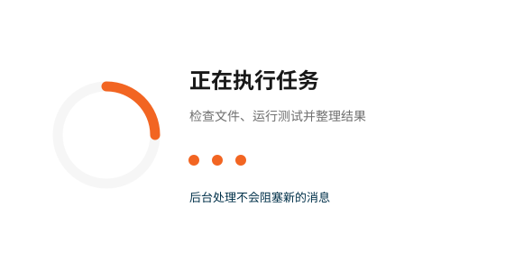</a> |

> GitHub 的 README 预览可能只显示静态帧。点击图片打开原始 SVG，或在本地主题总览页中查看完整 SMIL 动画。

## 示例

打开 [`examples/zh/index.html`](examples/zh/index.html) 可浏览全部中文主题示例。

每套主题都包含相同的 3 种布局：

- `智能体双层架构.svg`
- `文档审批流程.svg`
- `任务执行状态.svg`

因此可以只比较字体和配色，不受布局差异干扰。Web 专用交互示例位于 [`examples/web/interactive-network.html`](examples/web/interactive-network.html)。

本地启动示例：

```bash
python -m http.server 8765 --bind 127.0.0.1
```

然后访问：

```text
http://127.0.0.1:8765/examples/zh/index.html
```

## 目录结构

```text
animated-svg-studio/
├── SKILL.md
├── README.md
├── README.en.md
├── assets/
│   ├── preview-template.html
│   ├── starter.svg
│   └── themes.json
├── scripts/
│   ├── apply_theme.py
│   ├── build_preview.py
│   ├── inspect_compatibility.py
│   ├── optimize_svg.py
│   └── validate_svg.py
├── references/
├── examples/
│   ├── web/
│   └── zh/
└── evals/
```

## 运行要求

- Python 3.9+
- 无第三方 Python 依赖
- 浏览器仅用于视觉检查，不是生成 SVG 的必要条件

## 设计与兼容性原则

- 动画用于解释信息，而不是单纯装饰。
- 优先使用 `transform`、`opacity` 和路径描边动画。
- 第一帧和静态回退必须仍然可读。
- 所有说明性 SVG 应包含 `<title>` 和 `<desc>`。
- 发布到受限富文本平台前，应使用对应配置验证，并在真实客户端测试。
- 不承诺所有邮件客户端或内容清洗器都支持动画。

## 致谢与参考

本项目为独立实现，不包含下列页面的源码、图片、Logo 或专有资源。部分主题的色彩与字体方向参考了这些公开页面，在此致谢：

- 微信公众号技术文章：<https://mp.weixin.qq.com/s/lcIkBMOKHSvkRYELgkduMg>，用于早期暖色编辑主题的视觉研究。
- Mokkapps Slidev Theme：<https://slidev-theme-mokkapps.netlify.app/2>，用于暗红大会主题的字体与色彩研究。
- BeAPT Presentation：<https://beapt-presentation.netlify.app/7>，用于橙蓝架构主题的字体与色彩研究。

所有示例均为重新设计的原创 SVG，不分发上述页面的文章动画、背景图片或品牌素材。
